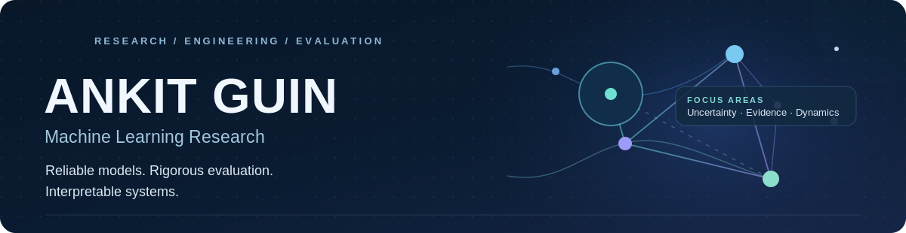

<!-- GitHub profile README | Repository: https://github.com/AnkitGuin/AnkitGuin -->

  

  <a href="mailto:ankitguin006@gmail.com"><strong>Email</strong></a>&nbsp;&nbsp;·&nbsp;&nbsp;
  <a href="https://www.linkedin.com/in/ankit-guin-1b035131a/"><strong>LinkedIn</strong></a>&nbsp;&nbsp;·&nbsp;&nbsp;
  <a href="https://github.com/AnkitGuin?tab=repositories"><strong>Repositories</strong></a>&nbsp;&nbsp;·&nbsp;&nbsp;
  <a href="https://codeforces.com/profile/Ankit37"><strong>Codeforces</strong></a>

### Hi, I'm Ankit.

I'm a **B.Tech student in Mechatronics Engineering at IIT Bhilai** and an **ML research intern at IIT Bhilai**. I enjoy turning questions about how models *behave, fail, and adapt* into reproducible experiments and working implementations.

My interests span **uncertainty quantification**, **probabilistic optimization**, **mechanistic interpretability**, and **trustworthy language-model systems**. Across projects, I prioritize meaningful baselines, leakage-aware evaluation, ablation studies, and clear reporting of limitations—not just a model that runs.

> **Research direction:** How can we make learning systems more reliable when data distributions shift, evidence is incomplete, or model behavior is difficult to explain?

---

## Selected research

<table>
  <tr>
    <td width="50%" valign="top">
      
<strong>01 · <a href="https://github.com/AnkitGuin/adaptive-conformal-shift">Adaptive Conformal Prediction under Shift</a></strong>

      
<em>Uncertainty quantification · Distribution shift · Online calibration</em>

      
Implemented conformal prediction and drift-aware recalibration for time-ordered regression, with controlled covariate, noise, and conditional shifts.

      
<strong>Research insight:</strong> Adaptive methods recovered approximately 90% marginal coverage where static intervals under-covered; simpler recency weighting was often as effective as explicit drift detection, with wider intervals as the trade-off.

    </td>
    <td width="50%" valign="top">
      
<strong>02 · <a href="https://github.com/AnkitGuin/adaptive-bayesian-optimization">Drift-Aware Bayesian Optimization</a></strong>

      
<em>Gaussian processes · Sequential decisions · Concept drift</em>

      
Implemented Gaussian-process regression, acquisition functions, time-decayed observations, and Page–Hinkley drift detection for optimizing non-stationary objectives.

      
<strong>Research method:</strong> Shared-budget baselines, controlled synthetic shifts, paired multi-seed experiments, recovery/regret metrics, and component ablations.

    </td>
  </tr>
  <tr>
    <td width="50%" valign="top">
      
<strong>03 · <a href="https://github.com/AnkitGuin/mechanistic-interpretability-rnn">Mechanistic Interpretability of RNNs</a></strong>

      
<em>Representation analysis · Dynamical systems · PyTorch</em>

      
Built RNN, GRU, and LSTM cells for experiments on formal languages and agreement patterns. Analyzed hidden-state trajectories through fixed points, Jacobian eigenvalues, linear probes, and representational similarity.

      
<strong>Research question:</strong> What structure do recurrent networks learn internally, beyond their task accuracy?

    </td>
    <td width="50%" valign="top">
      
<strong>04 · <a href="https://github.com/AnkitGuin/SciContradict">SciContradict</a></strong>

      
<em>Scientific NLP · Natural language inference · Evaluation</em>

      
Built a scientific claim-comparison pipeline with BERT, RoBERTa, SciBERT, and DeBERTa model paths, claim-pair construction, semantic retrieval, calibration, and error-analysis tooling.

      
<strong>Research question:</strong> How robustly can transformer models distinguish support, contradiction, and insufficient evidence in scientific text?

    </td>
  </tr>
  <tr>
    <td width="50%" valign="top">
      
<strong>05 · <a href="https://github.com/AnkitGuin/Fact-Anchor">FactAnchor</a></strong>

      
<em>Hallucination mitigation · Contrastive decoding · Factual grounding</em>

      
Developed a research prototype for contrasting normal next-token predictions with predictions conditioned on deliberately corrupted entity facts. Includes controlled corruption, evaluation hooks, and ablations.

      
<strong>Status:</strong> The end-to-end pipeline is smoke-tested offline; real-model factuality experiments remain to be validated.

    </td>
    <td width="50%" valign="top">
      
<strong>06 · <a href="https://github.com/AnkitGuin/PINN-QAE-Option-Pricing">PINN × Quantum Option Pricing</a></strong>

      
<em>Physics-informed ML · Inverse problems · Simulation</em>

      
Implemented a comparison of inverse-PINN and classical volatility calibration under walk-forward evaluation, connected to a simulated quantum amplitude estimation pricing pipeline.

      
<strong>Focus:</strong> Error decomposition, leakage controls, and reproducible comparisons—not claims of quantum advantage.

    </td>
  </tr>
</table>

## ML systems & applied work

| Project | What it explores |
|:--|:--|
| **[TruthGuard](https://github.com/AnkitGuin/TruthGuard)** | Multi-agent RAG pipeline for claim extraction, evidence verification, critique, and answer revision; includes an evaluation framework and Streamlit interface. |
| **[RagBench](https://github.com/AnkitGuin/RagBench)** | Modular benchmark for lexical, dense, and hybrid retrieval, with ranking metrics, resource measurements, and experiment configuration. |
| **[Semantic Tree Retrieval](https://github.com/AnkitGuin/semantic-tree-retrieval)** | Hierarchical K-Means retrieval over research-paper embeddings, with beam-search routing and a flat-search baseline; built for Inter-IIT Tech Meet 14.0. |
| **[AMPClassifier](https://github.com/AnkitGuin/amp-classifier)** | Protein-language-model fine-tuning pipeline for antimicrobial peptide classification. |
| **[CNC Quality & Tool Wear](https://github.com/AnkitGuin/CNC-Tool-Wear-Prediction)** | Sensor-driven prediction of CNC surface roughness and investigation of tool-condition effects. |
| **[Financial Time-Series Analysis](https://github.com/AnkitGuin/financial-time-series-analysis)** | ARIMA and ML comparisons using chronological splits and out-of-sample diagnostic analysis. |

---

## How I approach research

- **Establish strong baselines.** Compare against methods that are simpler, cheaper, and easier to reason about.
- **Test assumptions, not just accuracy.** Examine distribution shift, calibration, data leakage, robustness, and failure modes.
- **Make results reproducible.** Use fixed experimental protocols, seeded runs, ablations, tests, and documented limitations.
- **Build the tooling.** Create the pipelines, benchmarks, visualizations, and interfaces needed to investigate a hypothesis end to end.

## Tools & methods

| Modelling & statistics | Language models & retrieval | Research engineering |
|:--|:--|:--|
| Python · PyTorch · scikit-learn · NumPy · SciPy · XGBoost | Hugging Face Transformers · Sentence-Transformers · FAISS · RAG · NLI | Git · pytest · Jupyter · Docker · Streamlit · pandas · Plotly |

**Also exploring:** predictive maintenance with sequence models; physics-informed learning, computational finance, and quantum algorithms.

---

  <strong>Interested in rigorous AI/ML research, reproducible experiments, and thoughtful collaboration.</strong>
   
  Reach me at <a href="mailto:ankitguin006@gmail.com">ankitguin006@gmail.com</a> or connect on <a href="https://www.linkedin.com/in/ankit-guin-1b035131a/">LinkedIn</a>.

